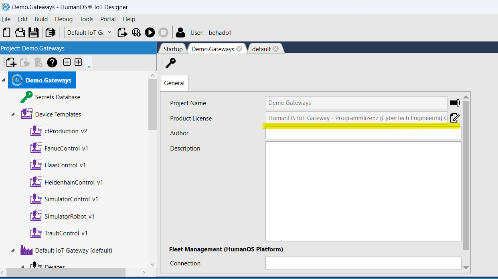
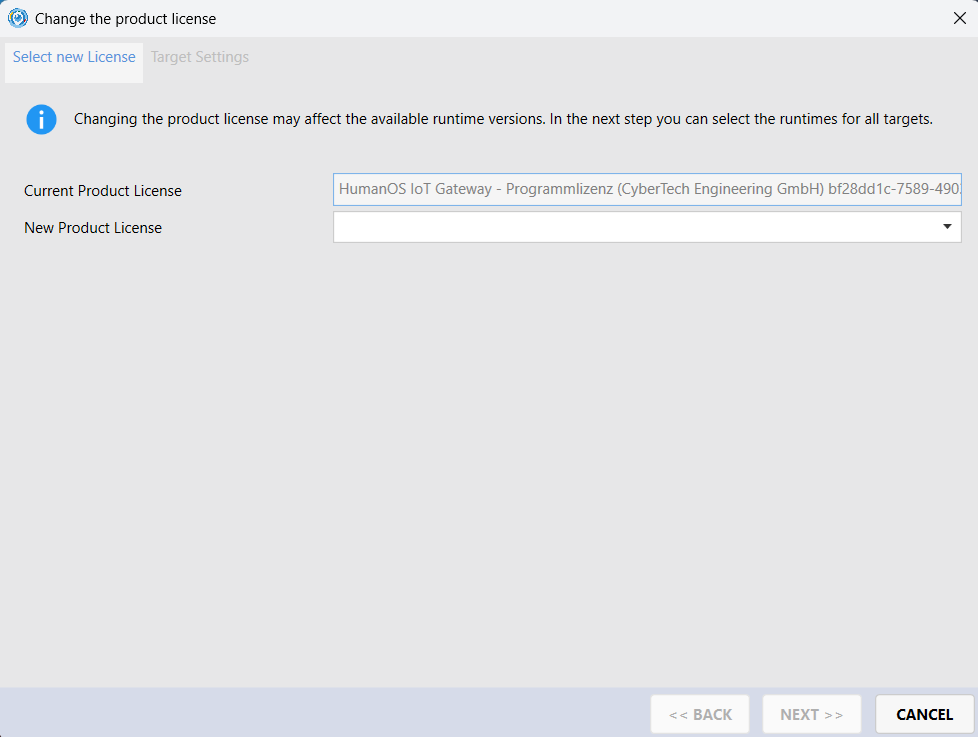

# ctProduction Agents

Collection of HumanOS Agents used to extend ctProduction Platform.

The agents require a valid HumanOS license. Get the license directly from [CyberTech Engineering Sales](mailto:info@cybertech.swiss).

## Releases

This repository is a release mirror. The agents are developed in CyberTech's ctProduction repository and
published here automatically when a change to them is merged there: one commit `Release <version>` and the
tag `v<version>`. The version is `<major>.<minor>.<build>`: major.minor is the ctProduction product version
the agents belong to, the build number is the pipeline number of the merge.

Commits pushed directly to this repository are not part of the development repository and are not
carried back; they block the next release until CyberTech has taken them over. Please send changes to
[CyberTech Engineering](mailto:info@cybertech.swiss) instead.

## Workplace and Machine Configurations

- ctProduction Container encompassing sub devices (facility components)
- [FANUC CNC](https://doc.cybertech.swiss/runtime/Manuals/HumanOS.UHAL.FanucControl/) Template
- HAAS CNC Template
- Traub OPC-UA Template
- [Heidenhain](https://doc.cybertech.swiss/runtime/Manuals/HumanOS.UHAL.HeidenhainControl/) (iTNC530, TNC64x, TNC7 native)
- [Simulators](https://doc.cybertech.swiss/runtime/Manuals/HumanOS.UHAL.FileReader/) for Machine Controls and Robots
- [Excel-Reader](./doc/excel-reader/Excel-Reader.md): syncs the maintenance orders of an Excel file into ctProduction maintenance jobs

## How to Switch the License

After cloning the repository, you have to switch the license in the HumanOS IoT projects.

1. Open the project in HumanOS IoT Designer
2. Double click on the root entry of the project
3. Click on the "edit" button next to the "Project License"

   

4. Select your license

   
